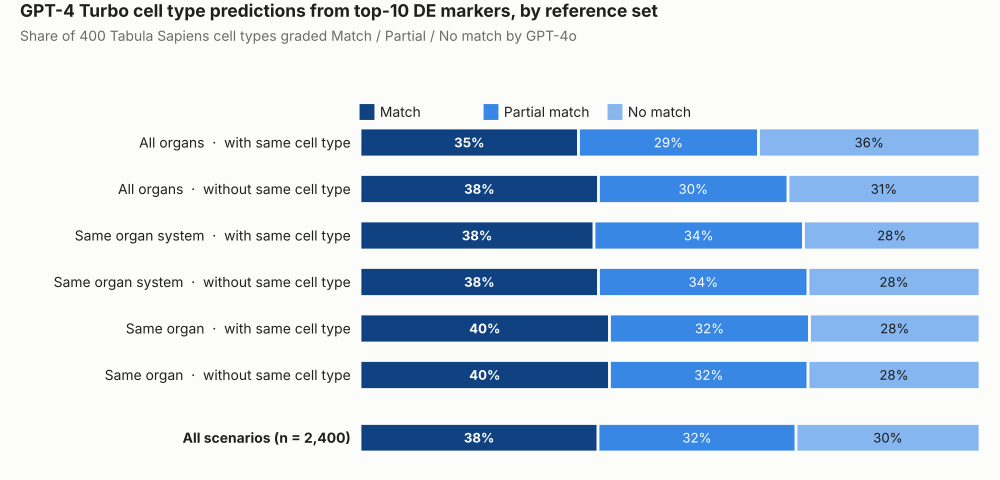

# Does the reference set matter for LLM-based cell type annotation?

A common shortcut for annotating single-cell clusters is to run differential
expression (DE), take the top marker genes and ask a large language model which
cell type they belong to. But marker genes are always relative to *something*.
This project tests whether the choice of reference cells used in the DE step
changes how well GPT-4 can name the cell type.

Pre-thesis project in Novo Nordisk Cell Therapy and University of Copenhagen,
spring 2025, by Gustav Helms and Anton Wang Strandberg.



## Key result

- Across 2,400 predictions (400 organ-specific cell types × 6 reference sets),
  GPT-4 Turbo named the cell type exactly in **38.4%** of cases, and exactly
  or partially in **70.3%**.
- The reference set made little difference (35–40% exact match). A narrow,
  same-organ reference did no worse than comparing against the whole atlas.
- Many "partial matches" are the right lineage at a coarser level
  (e.g. *myofibroblast* → *fibroblast*, *pericyte* → *smooth muscle cell*).

## Approach

```
Tabula Sapiens (10x)          01_preprocessing.Rmd
   │  QC + log-normalisation, on-disk matrix with BPCells
   ▼
Seurat FindMarkers × 6        02_differential_expression.Rmd
   │  one DE run per cell type and reference set
   ▼
Top 10 markers → GPT-4 Turbo  03_llm_prediction_and_evaluation.Rmd
   │  "which cell type is this?"
   ▼
GPT-4o as judge               (same notebook)
   │  Match / Partial Match / No Match vs. the annotation
   ▼
Summary + plots               04_visualization.Rmd
```

### The six reference sets

Each organ-specific cell type (e.g. *Pancreas – beta cell*) is compared against:

| Reference scope   | With same cell type from other organs | Without it |
|-------------------|:-------------------------------------:|:----------:|
| All organs        | ✓ | ✓ |
| Same organ system (e.g. digestive, uro-cardiac) | ✓ | ✓ |
| Same organ        | ✓ | ✓ |

"Without" removes cells of the same cell type in other organs from the
reference, so that e.g. pancreatic macrophages are not compared against lung
macrophages.

Cell types with fewer than 30 cells were excluded. Example prompts and LLM
responses are in [`figures/llm_example/`](figures/llm_example/).

## Repository structure

```
├── 01_preprocessing.Rmd                  # h5ad → BPCells → QC → normalised Seurat object
├── 02_differential_expression.Rmd        # 6 × FindMarkers per cell type → results/marker_logs/
├── 03_llm_prediction_and_evaluation.Rmd  # GPT-4 Turbo prediction + GPT-4o grading
├── 04_visualization.Rmd                  # plots of the results
├── R/
│   ├── config.R                # models, endpoint, thresholds, paths
│   ├── de_functions.R          # DE helpers
│   └── prediction_functions.R  # LLM prediction and evaluation
├── results/
│   └── results_predictions.csv # all 2,400 graded predictions
└── figures/
```

## Running it

1. Download the Tabula Sapiens `.h5ad` (v1, from the
   [Tabula Sapiens portal](https://tabula-sapiens-portal.ds.czbiohub.org/)) and
   place it at `data/tabula_sapiens/TabulaSapiens.h5ad`.
2. Copy `.Renviron.example` to `.Renviron` and add your API key. Any
   OpenAI-compatible chat completions endpoint can be set with `LLM_BASE_URL`.
   Model names are set in `R/config.R`.
3. Run the notebooks in order. Steps 02 and 03 log their progress and skip
   finished work, so they can be restarted after a crash.

To only reproduce the figure, run `04_visualization.Rmd`. It reads the
included `results/results_predictions.csv`.

**R packages:** Seurat, SeuratObject, SeuratDisk, BPCells, hdf5r, tidyverse,
httr, jsonlite.

## Limitations

- **LLM as judge.** Grading was done by GPT-4o, not by a human expert,
  and the line between Match and Partial Match is fuzzy.
- **Not reproducible as-is.** LLM outputs are not deterministic, and the
  original runs used Novo Nordisk's internal GenAI gateway. The included
  results file is the record of what was run.
- **One atlas, one prompt.** Only Tabula Sapiens (10x), top 10 genes ranked by
  adjusted p-value, and a single prompt were tested.
- This is exploratory project code, written in notebooks rather than as a
  package.

## License

MIT
